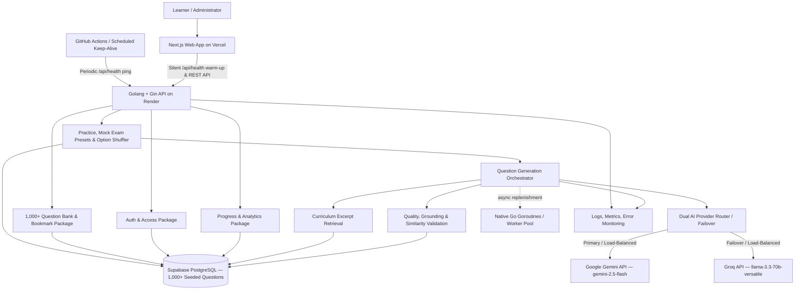

# Architectural Design — CloudPrep

**Status:** Proposed  
**Architecture style:** Modular monolith with asynchronous work where useful

## 1. Architectural goals

- Keep the first version straightforward to build, test, deploy, and operate.
- Enforce clear domain boundaries so modules can evolve independently.
- Protect exam integrity and learner data (including dynamic option shuffling and strict server-side answer key concealment in mock exams).
- Support a **1,000+ pre-seeded Question Bank** across multiple question styles (`DEFINITION`, `COMMAND_SYNTAX`, `COMPARISON`, `SCENARIO`) strictly grounded in `school notes/`.
- Integrate **both Google Gemini (`gemini-2.5-flash`) and Groq (`llama-3.3-70b-versatile`)** behind a unified provider abstraction with automatic failover and bank persistence.
- Support instant session creation from the 1,000+ bank alongside background/hybrid AI generation without coupling the learner interface to model APIs.
- Mitigate free-tier cold starts via a lightweight public `GET /api/health` endpoint triggered silently from the frontend entry pages.
- Keep question generation, validation, and similarity checks observable and cost-controlled.

## 2. High-level architecture

The diagram is logical. The first release deploys the Next.js web application on Vercel and the **Golang + Gin** API on Render connected to Supabase PostgreSQL via `GORM` + `pgx/v5`, while maintaining clean modular Go package boundaries.

## 3. Modules and responsibilities

### Identity and access
- Zero-friction registration (Name, Email, Password with instant sign-in—no email verification gate), sign-in, sign-out, and session/token lifecycle.
- **1-Click Guest Mode (`POST /api/auth/guest`):** Instant guest learner provisioning so visitors and evaluators can start practicing or taking mock exams in one click without filling out a registration form.
- Role and permission checks (`LEARNER`, `GUEST`, `ADMIN`).
- Ownership checks for learner sessions, bookmarks, and results.
- Administrator access restrictions and audit events.

### Curriculum
- Two course modules (**Module 1: Foundations** and **Module 2: Cloud Architecture & Services**) covering all 10 curriculum areas, learning objectives, and structured excerpts extracted from the 8 PDFs in `school notes/`.
- Mapping from question to curriculum topic, learning objective, and course module/week slide reference.
- Versioning of curriculum mappings where required.

### Question content (1,000+ Question Bank)
- Pre-seeded bank of **1,000+ approved questions** (~100+ per curriculum topic) plus growing AI-generated questions.
- Question and option records with support for **monospace code blocks and inline CLI/script syntax**.
- Question style classification:
  - `DEFINITION` (Definition & Concept Recall)
  - `COMMAND_SYNTAX` (CLI Commands, Bash Scripts, Git Syntax & Service Identification)
  - `COMPARISON` (Concept Comparison & Distinction)
  - `SCENARIO` (Scenario, Architecture & Troubleshooting)
- Answer key, explanation content, distractor rationales, and exact course module/week citations.
- Draft/review/approved/retired lifecycle and provenance (`SEED_BANK`, `AI_GEMINI`, `AI_GROQ`, `ADMIN`).
- Content versioning and editorial audit.

### Practice and exam
- Session creation and configuration (including **Question Style filter** in Practice Mode and **Module 1**, **Module 2**, and **Comprehensive Final** Mock Exam presets).
- Instant question selection from the 1,000+ bank (<200ms) combined with hybrid/background AI generation.
- **Dynamic per-session option order shuffling (`A–D`)** so learners cannot memorize option letters across attempts.
- Answer saving, flags, **question bookmarks for revision**, navigation state, authoritative server-deadline timer handling, submission, and scoring.
- Idempotent submission and review permissions.

### Dual-provider AI generation (Gemini + Groq)
- Builds generation context from topic, objective, requested **question style** (`DEFINITION`, `COMMAND_SYNTAX`, `COMPARISON`, `SCENARIO`), difficulty, `school notes/` excerpts, and exposure history.
- Calls **Google Gemini (`gemini-2.5-flash`)** and **Groq (`llama-3.3-70b-versatile`)** through a unified `QuestionGenerationProvider` router with automatic failover (if Gemini rate-limits or times out, automatically retries with Groq, and vice versa).
- Coordinates validation, bounded retries, and automatic persistence of validated questions into the PostgreSQL Question Bank.
- Falls back cleanly and immediately to the **1,000+ approved Question Bank** if both AI providers are unavailable or quota-limited.

### Quality and similarity
- Strict JSON schema validation.
- Required-field, option-count, and code-block formatting checks.
- Single-best-answer and distractor rationale checks.
- Strict course-grounding checks (ensuring questions stay within the jurisdiction of `school notes/`).
- Exact fingerprint and similarity checks against the 1,000+ bank.
- Question style, difficulty, and cognitive-level checks.
- Optional administrator review workflow.

### Progress, bookmarks, and analytics
- Topic accuracy, **question-style accuracy**, attempts, exposure, and recent activity.
- Personal **Saved / Bookmarked Questions** management for learner exam revision.
- Basic recommendation inputs based on weaker topics and styles.
- Reports based on submitted responses; avoid exposing private information to other learners.

### Administration
- Question bank explorer (1,000+ seeded + AI-generated items) and review queue.
- Bulk AI generation trigger (using Gemini or Groq) to expand specific topics or question styles.
- Approve, edit, reject, retire.
- Inspect source reference, AI provider metadata (`AI_GEMINI` / `AI_GROQ`), and validation outcomes.
- Audit privileged changes.

## 4. Architectural decisions

### Modular monolith first
A modular monolith reduces deployment and operational complexity while the product and workload are still evolving. Module boundaries and internal interfaces should be enforced in code. Split a module into a separate service only when there is a demonstrated scaling, reliability, or ownership need.

### Dual AI provider abstraction (Google Gemini + Groq)
Define an internal `QuestionGenerationProvider` interface with concrete adapters for **Google Gemini (`gemini-2.5-flash`)** and **Groq (`llama-3.3-70b-versatile`)**, coordinated by a `MultiProviderAiRouter`:
- **Automatic failover:** If the primary provider fails, times out, or hits a 429 rate limit, the router transparently switches to the secondary provider.
- **Load distribution:** Can alternate requests across Gemini and Groq to maximize free-tier quotas.
- **Zero-downtime bank fallback:** If neither provider is available or configured, the system serves unseen items from the 1,000+ database Question Bank.

### 1,000+ Question Bank + Instant Start with Background Replenishment
Rather than forcing learners to wait on live AI generation on every click:
- PostgreSQL is seeded with **1,000+ curriculum-grounded questions** (~100+ per topic across all 4 question styles).
- Practice and mock exam sessions start immediately from unseen bank questions when available, while background/hybrid AI calls replenish the bank asynchronously or on explicit learner/admin request.
- Validated AI questions are saved into PostgreSQL so the bank grows continuously beyond 1,000+ items.

### Dynamic Option Shuffling (`A–D`)
To prevent positional memorization when a question is revisited, the backend shuffles option order when creating a `SessionQuestion` record and stores the session-specific option mapping so scoring and review remain 100% deterministic across page refreshes.

### Render Cold-Start & Supabase Anti-Pause Mitigation
1. **Render Cold-Start Warm-Up (Go Advantage):** Because Render free-tier web services sleep after 15 minutes of inactivity, the **Golang + Gin** API compiles to a native binary (`~15–25 MB` RAM) that boots in milliseconds once the container starts. The Next.js frontend fires a silent background fetch to `GET /api/health` as soon as a visitor lands on `/` or `/login`, waking the container before the learner submits their login form or starts a session.
2. **Preventing Supabase 7-Day Inactivity Pause:** Supabase pauses free-tier databases after 7 days of zero database queries. To prevent this:
   - `GET /api/health` executes a lightweight PostgreSQL query (`SELECT 1` / cached question count query) against Supabase so every visitor wake-up ping registers real database activity.
   - A scheduled **GitHub Actions keep-alive cron** (`.github/workflows/keep-alive.yml`) automatically pings `GET /api/health` every 2–3 days so Supabase never pauses the database even during weeks with no human traffic.

### Database as source of truth
PostgreSQL stores user accounts, curriculum excerpts, the 1,000+ question bank, generation metadata, sessions (including shuffled option mappings), responses, bookmarks, results, and exposure history. Cache or queue state must not be the only copy of exam answers or submissions.

### Generated content lifecycle
AI-created items are candidates until they pass checks. Depending on the selected product mode, validated candidates can be stored as reusable approved/published content or used as session-scoped content with provenance. Administrative review can be required for broad reuse.

### Bounded AI work
Generation should have request quotas, maximum retries, model timeouts, token limits, and cost telemetry. A learner should not wait indefinitely for generation. If generation fails, serve eligible curated items or explain that the requested set could not be fully generated.

## 5. Trust boundaries and security

- Browser is untrusted; validate all input at the API.
- Enforce authorization server-side for every session, result, and admin operation.
- Keep model credentials and secrets outside the client.
- Avoid sending unnecessary personal data to the AI provider.
- Treat retrieved course excerpts and user-provided text as content, not instructions.
- Use secure cookies or an equivalent secure session strategy, CSRF protection where cookie-based authentication is used, and appropriate CORS policy.
- Rate-limit authentication, session creation, and AI generation endpoints.
- Record administrator changes and generation decisions.
- Use least-privilege IAM roles for AWS resources.
- Encrypt data in transit and at rest using managed capabilities where available.

## 6. Deployment view

Proposed first deployment:
- Next.js web frontend deployed on Vercel (with silent `GET /api/health` warm-up ping on `/` and `/login`).
- **Golang (`Go 1.22+`) + Gin Framework** API deployed as a Render web service (`~20 MB` memory footprint, sub-second startup).
- Supabase-hosted PostgreSQL database seeded with **1,000+ curriculum-grounded questions** (~3–5 MB total storage), connected via `GORM` + `pgx/v5`.
- **Google Gemini (`gemini-2.5-flash`)** and **Groq (`llama-3.3-70b-versatile`)** called only from the Render Go API through the dual-provider failover abstraction, with native Go goroutines handling background bank replenishment.
- GitHub for source control, CI checks, and scheduled keep-alive cron pinging `GET /api/health` so Supabase never pauses.
- Docker for local development consistency; it is not mandatory for Vercel hosting.
- Provider logs and a suitable free monitoring allowance for early observability.

Start without a separate queue or vector database—Go's native goroutines and channels handle asynchronous background AI replenishment in-process with minimal overhead. Free-tier services can have quotas, cold starts, and changing limits; design graceful timeouts, dual-AI failover, and instant fallback to the 1,000+ question bank.

## 7. Key quality attributes

| Attribute | Design response |
|---|---|
| Exam integrity | Server-side scoring, session ownership, dynamic option order shuffling (`A–D`), answer concealment in mock mode, idempotent submit |
| Content quality | Strict `school notes/` grounding, 4 balanced question styles (`DEFINITION`, `COMMAND_SYNTAX`, `COMPARISON`, `SCENARIO`), validation, module/slide citations |
| Variety | 1,000+ pre-seeded bank + dual-AI generation (Gemini & Groq), per-user exposure history, unseen-first selection, option shuffling |
| Reliability | Persisted session state, database transactions, Gemini <-> Groq automatic failover, zero-downtime 1,000+ bank fallback, Render `/api/health` warm-up |
| Cost | Free-tier dual AI (Gemini + Groq), generation quotas, bank persistence/reuse of validated AI items, token limits |
| Maintainability | Module boundaries, typed contracts, migrations, automated tests |
| Privacy | Minimize personal data sent to AI; private learner history, bookmarks, and access controls |

## 8. Risks and mitigations

- **AI can produce off-syllabus or incorrect content:** strict grounding in `school notes/` excerpts, automated schema & grounding checks, human review option, and 1,000+ curated bank fallback.
- **Learner memorizes option letters (`A/B/C/D`) or sees only one question format:** dynamic per-session option shuffling and 4 balanced question styles (definitions, commands/syntax, comparisons, scenarios).
- **AI provider rate limit or latency:** dual-provider failover (Gemini <-> Groq), instant session start from the 1,000+ bank (<200ms), and asynchronous background bank replenishment.
- **Render free-tier cold start delay:** silent `GET /api/health` wake-up ping fired when a user visits the public landing (`/`) or login (`/login`) page.
- **Question pool becomes uneven:** 100+ seeded questions per topic across all 10 curriculum areas and all 4 question styles.
- **Exam state can be lost:** persist responses, flags, and shuffled option mappings incrementally; test resume and submit behavior.
