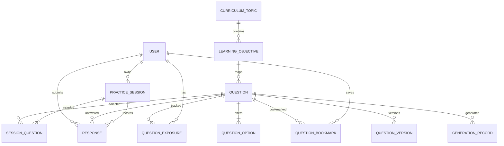
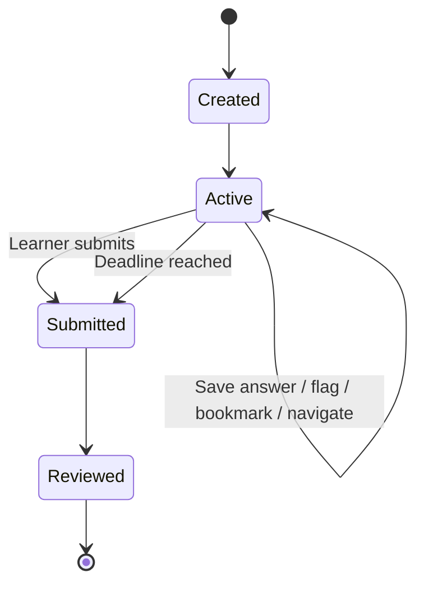
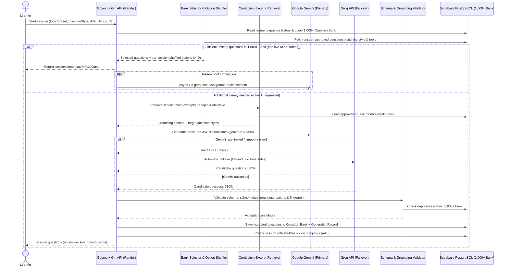

# System Design — CloudPrep

**Status:** Proposed technical design  
**Scope:** First usable release

## 1. Core data model

The following is a logical model. Exact columns, constraints, and indexes will be finalized during implementation.



### Main entities

- **User:** ID, name, email (nullable or auto-generated for guest accounts), password hash (nullable for guest accounts), `is_guest` flag, role (`LEARNER`, `ADMIN`), timestamps, status.
- **CurriculumTopic:** ID, module number (`1` for Cloud & DevOps Foundations, `2` for Cloud Architecture & Services), week code (`M1_W1`..`M2_W4`), title, description, source PDF reference, ordering.
- **LearningObjective:** ID, topic ID, objective statement, curriculum excerpt / slide summary, reference metadata.
- **Question:** ID, stem (supports Markdown/monospace code blocks), topic/objective mapping, **question style** (`DEFINITION`, `COMMAND_SYNTAX`, `COMPARISON`, `SCENARIO`), difficulty (`FOUNDATIONAL`, `INTERMEDIATE`, `ADVANCED`), cognitive skill, scenario type (optional for non-scenario styles), status (`DRAFT`, `APPROVED`, `RETIRED`), **source type** (`SEED_BANK`, `AI_GEMINI`, `AI_GROQ`, `ADMIN`), **source reference** (e.g., `Module 1, Week 2 — Linux File Permissions`), normalized fingerprint, current version.
- **QuestionOption:** ID, question ID, canonical option key (`A`, `B`, `C`, `D`), option text (supports inline monospace code), distractor rationale, ordering.
- **QuestionVersion:** immutable snapshot of stem/options/correct answer/explanation/distractor rationales and content metadata.
- **GenerationRecord:** AI provider (`GEMINI` or `GROQ`), model ID (`gemini-2.5-flash` or `llama-3.3-70b-versatile`), failover indicator, prompt version, requested question style, validation status, similarity results, token/cost metadata, failure details.
- **PracticeSession:** ID, user ID, mode (`TOPIC_PRACTICE`, `MIXED_PRACTICE`, `REVIEW_MISTAKES`, `BOOKMARK_REVISION`, `MOCK_EXAM`), exam preset (`MODULE_1`, `MODULE_2`, `COMPREHENSIVE_FINAL`, or `CUSTOM`), settings (selected topics, question style filter, difficulty, feedback timing), status, start/end timestamps, deadline, score.
- **SessionQuestion:** session ID, question/version ID, order, **shuffled option mapping** (per-session randomized permutation of `A, B, C, D` -> canonical option keys so learners cannot memorize option positions), flag state, exposure classification.
- **Response:** session ID, user ID, question/version ID, selected option (resolved via `SessionQuestion` shuffled mapping), correctness, answered time.
- **QuestionExposure:** user ID, question/version ID, last seen, number of exposures, outcomes.
- **QuestionBookmark:** ID, user ID, question ID, optional learner note, created timestamp (unique per user + question).
- **AuditEvent:** actor, action, entity, timestamp, relevant non-sensitive metadata.

### Important constraints and indexes

- Unique user email (or identity-provider subject).
- Unique canonical option key per question.
- One response per learner/session/question; use a unique constraint.
- Unique bookmark per learner/question (`user_id`, `question_id`).
- One session submission/result per session; use a transactional state transition.
- Index sessions by user and creation time.
- Index questions by topic, **question style**, status, difficulty, source type, and objective.
- Index exposure by user and question/version.
- Store a normalized fingerprint for exact duplicate detection across the **1,000+ pre-seeded Question Bank** and newly generated Gemini/Groq candidates.
- For the free-tier-first MVP, begin with normalized fingerprints and PostgreSQL trigram/full-text matching (`~3–5 MB` storage for 1,000+ questions, well under Supabase's 500 MB free limit).

## 2. Practice-session lifecycle



- Session creation chooses mode, exam preset (`MODULE_1`, `MODULE_2`, `COMPREHENSIVE_FINAL`, or custom topic selection), question style filter (`ALL`, `DEFINITION`, `COMMAND_SYNTAX`, `COMPARISON`, `SCENARIO`), number of questions, and time constraints.
- The server selects eligible questions from the **1,000+ Question Bank** (and/or validated Gemini/Groq candidates), generates a **per-session shuffled option order (`A–D`)** for each selected question, and records the selected versions.
- Answer changes, flags, and bookmarks are persisted as the learner interacts.
- Mock mode returns question text and shuffled options (`A–D`) but **never** answer keys, correctness flags, or explanations before submission.
- Submission is processed transactionally and is idempotent.
- Scoring resolves the learner's selected option against the session's shuffled option mapping and immutable question version.
- Review access is enabled according to the mode's feedback policy and includes the full explanation, distractor rationales, and exact course module/week citation.

## 3. Question selection, option shuffling, and anti-repetition

Selection combines the **1,000+ pre-seeded Question Bank** (~100+ questions per topic across all 10 curriculum areas) with validated AI candidates from **Google Gemini** and **Groq**.

### Eligibility and ranking
1. Filter by selected curriculum topics (or Module 1 / Module 2 / Final preset), **question style filter** (in Practice Mode; Mock Exams always draw a balanced mix of ~30% `DEFINITION`, ~25% `COMMAND_SYNTAX`, ~20% `COMPARISON`, and ~25% `SCENARIO`), difficulty bounds, and `APPROVED` status.
2. Exclude questions recently seen by the learner where unseen alternatives exist in the 1,000+ bank.
3. Prefer questions with lower exposure counts for that learner.
4. Preserve the requested topic, question style, and difficulty distribution.
5. Avoid selecting multiple questions that assess the exact same narrow fact in one session unless intended.
6. Randomize among comparable candidates using server-side randomness.
7. **Shuffle option order (`A–D`):** For every selected question, randomize the order of options for this session and store the permutation on `SessionQuestion` so even if a question is ever revisited later, the correct answer letter changes.
8. Record every selected question/version in the session and exposure history.

### Instant start + background / hybrid AI replenishment
- **Instant Start (<200ms):** When the 1,000+ bank has enough unseen questions matching the learner's criteria, the session starts immediately without blocking on an external LLM call (unless the learner explicitly toggles *"Generate Fresh AI Questions Now"*).
- **Background Replenishment & Hybrid Growth:** When a learner's unseen count for a topic/style drops below a threshold (or during hybrid sessions), the backend asynchronously invokes **Gemini (`gemini-2.5-flash`)** or **Groq (`llama-3.3-70b-versatile`)** to generate and validate new curriculum-grounded questions and inserts them into the PostgreSQL Question Bank.

### Similarity
- Exact: normalize stem and option text (stripping punctuation/casing) and hash the content (`content_fingerprint`).
- Near-duplicate check: compare normalized stems and key terms against existing questions in the same topic/objective.
- Any candidate exceeding similarity thresholds is rejected or retried.

### Exhaustion behavior
If the learner has seen all eligible items in the 1,000+ bank for a topic:
- Generate validated new questions via **Gemini** (failing over to **Groq**) if quota permits.
- If both AI providers are unavailable or quota-limited, serve a refreshed set from the 1,000+ bank with **newly shuffled option orders (`A–D`)** and a clear note that some questions may revisit earlier concepts.

## 4. Dual-AI generation pipeline (Google Gemini + Groq)



### Prompt/context requirements
The generation request, assembled by the Render-hosted API for **Gemini** or **Groq**, must include:
- Curriculum module, week, topic, and learning objective.
- Approved course excerpts extracted from the 8 PDFs in `school notes/`.
- Target **question style**:
  - `DEFINITION`: direct definition, terminology, or core concept recall.
  - `COMMAND_SYNTAX`: Linux command, Bash script snippet, Git CLI flag, or cloud service/policy syntax (using markdown backticks/code blocks where appropriate).
  - `COMPARISON`: contrasting two or more related concepts/services from the notes.
  - `SCENARIO`: realistic startup/growing-company/enterprise design or troubleshooting situation.
- Difficulty (`FOUNDATIONAL`, `INTERMEDIATE`, `ADVANCED`) and cognitive skill.
- Existing question stems/fingerprints in that subtopic to prevent duplicates.
- Strict instruction to stay **100% within the jurisdiction of the supplied course material** and include an exact course module/week citation (`source_reference`).
- Strict JSON schema output requirement.

### Candidate schema (conceptual)
Each candidate must include:
- `stem` (supports inline `` `code` `` and fenced ```code blocks```)
- `question_style` (`DEFINITION` | `COMMAND_SYNTAX` | `COMPARISON` | `SCENARIO`)
- `options` (4 distinct choices with keys `A`, `B`, `C`, `D` and text)
- `correct_option_key` (`A` | `B` | `C` | `D`)
- `explanation` (clear explanation of why the correct option is right)
- `distractor_rationales` (why each of the other 3 options is wrong)
- `topic_id` and `objective_id`
- `difficulty` (`FOUNDATIONAL` | `INTERMEDIATE` | `ADVANCED`)
- `cognitive_skill` (`RECALL` | `COMPREHEND` | `APPLY` | `ANALYZE` | `TROUBLESHOOT`)
- `source_reference` (e.g., `"Module 1, Week 2 — Linux Fundamentals: File Permissions & chmod"`)
- `content_fingerprint`

### Validation gates
- JSON/schema and required-field validation.
- Exactly 4 distinct options (`A`, `B`, `C`, `D`).
- Correct option key exists and matches one option.
- Valid `question_style` matching the request.
- Explanations and per-distractor rationales are present and non-empty.
- Topic/objective mapping and `source_reference` correspond to the 10 approved curriculum topics and 8 `school notes/` PDFs.
- No off-syllabus claims or conflicting constraints.
- Exact fingerprint and near-duplicate text similarity checks against the 1,000+ bank.
- Bounded retry count; if both Gemini and Groq fail validation or time out, immediately fill remaining slots from the 1,000+ curated Question Bank.

## 5. API outline

The following endpoints are illustrative REST routes.

### Health, cold-start warm-up & Supabase anti-pause heartbeat (Public)
- `GET /api/health` — Public endpoint on the **Golang + Gin** API that:
  1. Wakes up the Render free-tier Go container when called silently by the Next.js landing (`/`) and login (`/login`) pages.
  2. Executes a lightweight PostgreSQL query (`SELECT 1` / cached question count query) on **Supabase PostgreSQL** so every health check registers real database activity, preventing Supabase from pausing the project after 7 days of inactivity.
  3. Is also called automatically every 2–3 days by a scheduled **GitHub Actions keep-alive cron** (`.github/workflows/keep-alive.yml`) so Supabase never pauses even if zero human visitors open the site during a week.

### Authentication
- `POST /api/auth/register` — Zero-friction Name, Email, Password registration (returns active session immediately; no email verification wall).
- `POST /api/auth/login` — Email & password sign-in.
- `POST /api/auth/guest` — 1-click guest learner provisioning (creates/resumes a guest learner session immediately).
- `POST /api/auth/logout`
- `GET /api/me`

### Curriculum, practice, mock exams, and bookmarks
- `GET /api/curriculum` — Returns Module 1 & Module 2 topics, objectives, question counts from the 1,000+ bank, and built-in Mock Exam presets (`MODULE_1`, `MODULE_2`, `COMPREHENSIVE_FINAL`).
- `POST /api/practice-sessions` — Supports `mode`, `examPreset`, `topicIds`, `questionStyle` (`ALL`, `DEFINITION`, `COMMAND_SYNTAX`, `COMPARISON`, `SCENARIO`), `difficulty`, `count`, `feedbackMode`, and `useAiGeneration`.
- `GET /api/practice-sessions/:sessionId` — Returns session questions with per-session shuffled options (`A–D`) and omits answer keys in active mock exams.
- `PUT /api/practice-sessions/:sessionId/responses/:questionId`
- `PUT /api/practice-sessions/:sessionId/questions/:questionId/flag`
- `POST /api/practice-sessions/:sessionId/submit`
- `GET /api/practice-sessions/:sessionId/review` — Returns scored responses, explanations, distractor rationales, and exact `source_reference` citations.
- `GET /api/bookmarks` — List learner's saved/bookmarked questions for revision (filterable by topic and question style).
- `POST /api/bookmarks/:questionId` — Bookmark a question (with optional learner revision note).
- `DELETE /api/bookmarks/:questionId` — Remove a question bookmark.
- `GET /api/progress/summary` — Topic accuracy, **question-style accuracy**, attempt counts, and recommended study areas.

### Content administration
- `GET /api/admin/questions` — Filterable by `topicId`, `questionStyle`, `status`, `sourceType` (`SEED_BANK`, `AI_GEMINI`, `AI_GROQ`, `ADMIN`), and `difficulty`.
- `POST /api/admin/questions`
- `POST /api/admin/questions/generate` — Trigger on-demand batch generation via Gemini/Groq for a topic and question style to expand the bank.
- `PATCH /api/admin/questions/:questionId`
- `POST /api/admin/questions/:questionId/approve`
- `POST /api/admin/questions/:questionId/retire`
- `GET /api/admin/generation-records/:recordId`

All protected routes require authentication and server-side authorization. Admin routes must not be accessible by changing a client-side role or URL.

## 6. Transaction and idempotency design

### Answer saving
- Upsert response by the unique session/question key.
- Validate that the session belongs to the user and is active.
- Validate that the selected option belongs to the session's question version.
- Reject answer changes after the session is submitted or expired, according to policy.

### Submission
- Use a transaction to lock or conditionally transition the session from `ACTIVE` to `SUBMITTED`.
- Calculate score against the immutable question versions.
- Persist result and response correctness.
- Return the existing result if the same submission is retried.
- Use a unique constraint/state transition to prevent duplicate scoring.

### AI generation request
- Accept an idempotency key for session creation/generation requests where duplicate client retries are possible.
- Record generation request status and retry policy.
- Apply per-user quotas and global cost limits.

## 7. Reliability and failure handling

- If AI provider is unavailable, use eligible approved questions.
- If generated candidates fail validation, discard them and use bounded retries.
- If generation cannot fill the requested set, return a smaller set or ask the learner to adjust the request rather than serving unchecked content.
- Persist answers incrementally so a network interruption does not erase progress.
- Use background jobs for slower generation/embedding work when the workload warrants it.
- Keep the API responsive with timeouts, cancellation, and clear session states.
- Monitor failure rate, latency, token usage, and candidate rejection reasons.

## 8. Security and privacy checklist

- Hash passwords with a modern password hashing algorithm if credentials are managed directly.
- Use secure, HttpOnly, SameSite cookies or a well-reviewed session approach.
- Apply CSRF protection where applicable.
- Validate and sanitize inputs; avoid rendering untrusted HTML.
- Enforce ownership checks on every learner-owned resource.
- Use least-privilege roles and administrator audit events.
- Store secrets in a managed secret store, not source control.
- Avoid sending email, credentials, or unrelated learner profile fields to the model.
- Define retention and deletion behavior for learner records and generation logs.
- Protect against prompt injection in retrieved text by treating source material as data and constraining output to the requested schema.

## 9. Testing strategy

- Unit tests for selection, scoring, session state, validation, and similarity policies.
- Integration tests for database constraints and transaction behavior.
- API tests for authentication, authorization, and ownership.
- Tests that mock AI-provider responses: valid, malformed, unsupported, duplicate, timeout, and provider failure.
- Regression suite of approved questions and expected answers.
- End-to-end tests for topic practice, mock exam, refresh/resume, submit retry, and review.
- Load tests for session start, response saving, and AI-generation concurrency before broader release.

## 10. Implementation sequence

1. Confirm requirements and multi-style question blueprint (`DEFINITION`, `COMMAND_SYNTAX`, `COMPARISON`, `SCENARIO`).
2. Build curriculum and **1,000+ pre-seeded Question Bank** data model & seed dataset extracted from `school notes/`.
3. Implement authentication, session lifecycle, dynamic option order shuffling (`A–D`), answer persistence, bookmarking, and scoring.
4. Build learner practice (with Question Style filter), Module 1 / Module 2 / Final mock-exam UI, and monospace code-block rendering.
5. Add explanations, distractor rationales, course module/week citations, results,bookmarks revision, and exposure tracking.
6. Wire **both Google Gemini (`gemini-2.5-flash`) and Groq (`llama-3.3-70b-versatile`)** behind the `QuestionGenerationProvider` failover router.
7. Add schema/grounding validation, fingerprint deduplication, automatic bank persistence, and 1,000+ bank fallback.
8. Build admin review, bulk bank generation tools, and analytics.
9. Add silent `GET /api/health` cold-start warm-up, deployment, observability, and security review.


## 11. Deployment and environment configuration

### Request path
1. Visitor opens the Next.js application on Vercel (`/` or `/login`), which immediately fires a silent background `GET /api/health` ping to wake up the Render free-tier **Golang + Gin** container and execute a lightweight query on Supabase PostgreSQL (resetting Supabase's 7-day inactivity timer).
2. The frontend sends HTTPS requests to the **Golang + Gin** API on Render.
3. The Go API authenticates and authorizes the request, then reads/writes Supabase PostgreSQL (containing the **1,000+ Question Bank**) via `GORM` + `pgx/v5`.
4. When additional question variety or background replenishment is needed (via native Go goroutines), the API calls **Google Gemini** (or automatically fails over to **Groq**) server-side.
5. The API validates candidates, persists accepted questions into the Supabase PostgreSQL Question Bank, shuffles option orders (`A–D`) for the session, and returns session content.

### Environment configuration

**Vercel frontend**
- `NEXT_PUBLIC_API_BASE_URL`: public HTTPS base URL of the Render Go API.

**Render API (Golang + Gin)**
- `DATABASE_URL`: Supabase PostgreSQL connection string suitable for the Go `pgx/v5` / `GORM` connection pool.
- `DIRECT_URL`: optional direct connection string if used for migrations/seeding.
- `JWT_ACCESS_SECRET` and `JWT_REFRESH_SECRET`: authentication secrets.
- `FRONTEND_ORIGIN`: deployed Vercel origin (and explicitly configured local origin in development).
- `AI_PRIMARY_PROVIDER`: `gemini` or `groq` (default: `gemini`).
- `AI_FALLBACK_PROVIDER`: `groq` or `gemini` (default: `groq`).
- `GEMINI_API_KEY` and `GEMINI_MODEL_ID` (default: `gemini-2.5-flash`).
- `GROQ_API_KEY` and `GROQ_MODEL_ID` (default: `llama-3.3-70b-versatile`).

Do not expose database credentials, service-role keys, JWT secrets, or Gemini/Groq API keys through `NEXT_PUBLIC_*` variables or frontend bundles.

### Database connection and migrations
- Configure Go's `sql.DB` pool (`SetMaxOpenConns`, `SetMaxIdleConns`, `SetConnMaxLifetime`) following Supabase connection guidelines.
- Run GORM auto-migrations and the **1,000+ question bank Go seed command (`cmd/seed`)** deliberately as part of release/deployment operations.
- Test connection limits and reconnect behavior, especially after Render service inactivity.

### Free-tier resilience
- Mitigate API cold starts on free hosting via the compiled **Golang + Gin** binary (`~20 MB` RAM, sub-second boot) + the silent `GET /api/health` ping on public entry pages (`/`, `/login`).
- Prevent Supabase's 7-day free-tier pause by having `GET /api/health` execute a lightweight PostgreSQL query against Supabase and running a scheduled GitHub Actions keep-alive cron every 2–3 days.
- Start sessions from the **1,000+ Question Bank** in `<200ms` when unseen items are available, using background Go goroutines for Gemini/Groq calls so learners never wait unnecessarily.
- Automatically fail over between **Gemini** and **Groq** on rate limits or transient errors, and fall back to the 1,000+ curated Question Bank if both are unavailable.
- Track database storage (~3–5 MB for 1,000+ questions out of 500 MB free tier), egress, AI token usage, and hosting quotas.
- Verify current free-tier limits before launch; do not design around assumed unlimited usage.

## 12. Definition of Done — 7 Core Verification Questions

For CloudPrep to count as successfully built, any evaluator, instructor, or learner testing the deployed platform must be able to answer **"YES"** to all seven verification questions below:

### 1. Does it test the actual course curriculum across all question styles (not just scenarios)?
- Are all **10 curriculum topics** (Module 1: Intro to Cloud, Linux, Bash, Git; Module 2: Compute & IAM, Networking, Storage, Databases, Serverless, Cloud AI & MLOps) present and strictly grounded in the 8 PDFs in `school notes/`?
- Does the platform test **Definitions & Recall**, **CLI Commands & Syntax** (Linux, Bash, Git), **Concept Comparisons**, and **Real-World Scenarios**—and can a learner filter by these styles in Practice Mode?
- Are there **1,000+ pre-seeded, validated questions** (~100+ per topic) already in the Supabase PostgreSQL database?

### 2. Does it prevent rote memorization when a learner practices repeatedly?
- When the same learner starts a second or third practice session on the same topic, do they receive **different (unseen) questions** rather than the same static quiz?
- If a question is revisited later, are the **answer options (`A, B, C, D`) dynamically shuffled** per session so a student cannot pass simply by memorizing option letters?

### 3. Does the Dual-AI engine (Google Gemini + Groq) work seamlessly with a 100% reliable fallback?
- Can the backend generate new, curriculum-grounded questions using **Google Gemini (`gemini-2.5-flash`)** and automatically fail over to **Groq (`llama-3.3-70b-versatile`)** if the primary provider hits a rate limit or error?
- Are valid AI-generated questions saved into the PostgreSQL database so the question bank grows over time?
- **Reliability verification:** If both AI providers are disabled or out of quota, does a practice or mock exam session **still start in `<200ms`** using the 1,000+ Question Bank without failing or blocking the student?

### 4. Do the Timed Mock Exams uphold real exam integrity?
- Can a learner take the **Module 1 Mock Exam**, **Module 2 Mock Exam**, and **Comprehensive Final Mock Exam** with an authoritative server-deadline countdown timer?
- During an active mock exam, is it **impossible** to see the correct answer or explanation (including in the browser DevTools Network tab) before clicking Submit?
- If the learner refreshes the browser tab or temporarily loses internet mid-exam, are their **selected answers, shuffled option order, flagged questions, and remaining time preserved**?
- If the learner double-clicks "Submit", does it create **only one** final score record (idempotent submission)?

### 5. Does the feedback actually help a student learn and revise?
- After submitting, does every question show:
  1. Why the correct answer is right,
  2. Why each wrong option (distractor) is incorrect, and
  3. The **exact course module & week reference** (e.g., *Module 1, Week 2 — Linux Fundamentals*)?
- Are Linux commands, Bash scripts (`#!/bin/bash`), Git flags, and IAM policies rendered in **clean monospace code blocks**?
- Can the learner **bookmark** tricky questions and review them anytime in the **Saved / Bookmarks (`/bookmarks`)** page, as well as see their weak topics and styles on the **Progress** dashboard?

### 6. Can anyone start using it in seconds without friction?
- Can an evaluator or student click **"Continue as Guest"** and enter the dashboard to start a quiz in **1 click**?
- Can a student sign up with just **Name, Email, and Password** (no email verification blocker) and have their history, exposure tracking, and bookmarks saved across sessions?

### 7. Is it cleanly deployed, secure, and responsive on free-tier hosting?
- Do the Landing (`/`) and Login (`/login`) pages silently ping `GET /api/health` so the Render free-tier backend wakes up quickly?
- Does the UI work cleanly on both **desktop and mobile screens** without horizontal overflow?
- Are all secrets (`DATABASE_URL`, `GEMINI_API_KEY`, `GROQ_API_KEY`, `JWT_ACCESS_SECRET`) kept strictly on the backend and never exposed to the browser?
